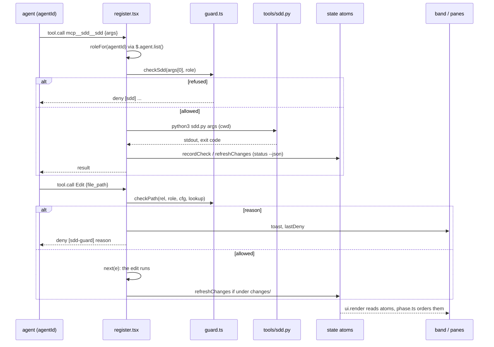

# Plugin architecture

```
plugins/meta/sdd/
├── .claude-plugin/plugin.json   manifest; "types" points at types/index.d.ts
├── skills/change/               the lead workflow (/sdd:change) + templates/ for new files
├── skills/formats/              format rules, preloaded into authoring agents (not user-invocable)
├── agents/                      spec-author, planner, acceptance-tester, implementer, verifier
├── tools/sdd.py                 deterministic spec tool, git and gh calls
├── hooks/hooks.json             { "modules": ["./register.tsx"] }
├── hooks/register.tsx           the mod: I/O and drawing only
├── hooks/guard.ts               write rules, pure functions
├── hooks/phase.ts               phase derivation and ordering, pure functions
├── types/index.d.ts             SddChange/SddTask/SddCheck/SddAgent + plugin state atoms
└── tests/                       test_sdd.py, guard.test.ts, phase.test.ts, mod.test.tsx
```

## Layers

| Layer | Owns | Must not |
|---|---|---|
| `tools/sdd.py` | every write to specs, ADR status, `frozen.json`, `state.json` and the archive; all git and `gh` calls; traceability; context bundles | call a model; produce chatty output |
| `hooks/guard.ts` | who may write what: `roleOf`, `checkPath`, `checkBash`, `checkSdd`, `SDD_RULES`, `memoryDirs` | do I/O (it gets a `Lookup` for statuses) |
| `hooks/phase.ts` | `PHASES`, `phaseOf`, `phasesOf`, `stepOf`, `byActivity`, `byPhase` | do I/O |
| `hooks/register.tsx` | hooks: `prompt.compose` (lead section), `session.start` (tool + command + timers), `command.run` (`/sdd`), `tool.call` (sdd tool, guard), `agent.spawn`, `turn.complete`, `ui.render` (band, two panes); state atoms | contain rules or phase logic |
| `skills/change` | the workflow the lead follows, step names, routing | duplicate format rules |
| `skills/formats` | the formats `sdd.py` parses, as writing rules | drift from `sdd.py` |
| `agents/*` | one job each, minimal tools, `memory: project` | write outside their role's paths |

## Data flow



1. An agent calls `mcp__sdd__sdd` with `args`. `register.tsx` maps its `agentId` to a role, `checkSdd` allows or refuses, then it runs `python3 tools/sdd.py <args>` in the session cwd.
2. Any write tool or Bash call goes through the guard hook: role, root and cwd bases, config, then `checkPath` / `checkBash`.
3. The band and panes read state atoms filled by `sdd status --json` (`refreshChanges`) and `$.agent.list()` (`refreshAgents`). They render with `phase.ts`.

## Why this split

The rules and the phase logic are pure, so they're unit-tested without a session. `sdd.py` is black-box tested in a throwaway git repo, against a bare origin and a fake `gh`. The mod is thin enough that its tests only check wiring and rendering. See [Testing](testing.md).
