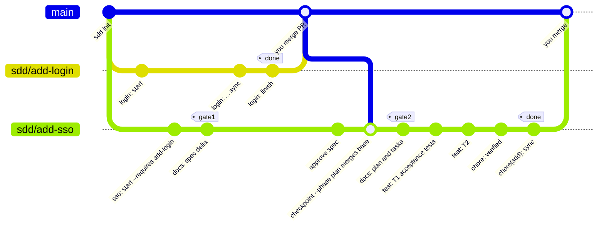
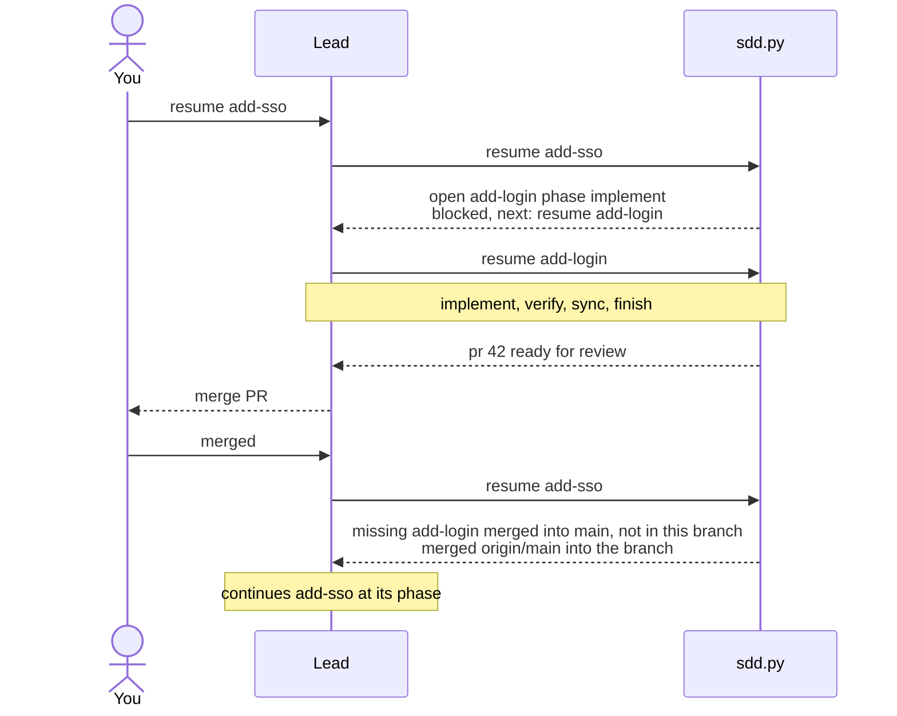

# Branches, PRs and checkpoints

## One change, one branch, one worktree, one draft PR

`sdd start` makes all four at once, before any artifact exists. Here is why each one is there.

- **Branch**: a change's spec, plan, tests and code travel together and merge together. Reviewers see the spec delta next to the code that implements it.
- **Worktree**: several changes can be open at once without switching branches under each other. The lead enters the change's worktree, and from there every `sdd` call resolves to that change's files (see [project root](../reference/configuration.md#project-root)).
- **Draft PR**: the change is visible from the first commit. It stays draft until `sdd finish`, which marks it ready. Merging is always left to you.

## Checkpoint after every artifact

After the spec, the plan, each test task, each impl task and each fix, the lead runs `sdd checkpoint <id> [--phase P] -m "<conventional message>"`. That one call stores the phase in `state.json`, commits everything and pushes.

- **Resumable anywhere.** The branch on `origin` always holds the latest artifact and the phase it reached. On another machine or in a new session, `/sdd:change resume <id>` fetches it and tells the lead which step comes next.
- **Phase can't lie.** The phase is recorded in the same commit as the work, so it never runs ahead of what is pushed. If a step finished but wasn't checkpointed, the files win over the stored phase.
- **History is readable.** One conventional commit per artifact (`docs(<id>): spec delta`, `test(<id>): T1 acceptance tests`, `feat(<id>): T2 ...`).

The lead never runs `git commit` or `git push` itself. Implementers run one at a time in the change's worktree, so there are no side branches to merge.

`sync` and `finish` take the base in too: `sync` merges `origin/<base>` before it checks the delta, so a unit another change edited and merged first is a CONFLICT, not an overwrite; `finish` merges it again if it moved while the change was being synced. See [Why sdd.py exists](determinism.md#base-hashes-turn-races-into-conflicts).

The life of a change branch, from `start` to your merge. Here a required change (`add-login`) merges into `main` while `add-sso` is still at Gate 1:

## Dependencies: "merged" is the only done

A change can depend on others still open (`--requires a,b`). The question is when a dependency counts as done. sdd's answer: when its archive directory (`changes/archive/<date>-<dep>/`, created by `sync`) is on `origin/<base>`. In other words, when its PR is merged.

- That's the moment its specs and code are on the base. Before that, building on it means building on something that could still change in review.
- It works with squash merges, because it looks for a directory, not a commit.
- It needs no API: a `git ls-tree` on the fetched base answers it.

Spec work may start before dependencies merge, since writing requirements doesn't need their code. Planning and everything after waits (`checkpoint --phase plan` and `resume` refuse). When the dependencies merge, the next `checkpoint --phase` or `resume` merges `origin/<base>` into the change branch, so their specs and code arrive.

When a resume is blocked, the lead goes depth-first: it resumes the unfinished dependency, finishes it, and asks you to merge its PR, then comes back. Cycles are refused when `requires` is set.

## Trade-offs

- Resume only fast-forwards. A diverged local branch is left for you to fix rather than guessed at.
- A conflicting base merge is aborted with the file list rather than half-applied.
- A dependency closed without merging blocks until you clear it.

See [Known limits](../reference/known-limits.md).
