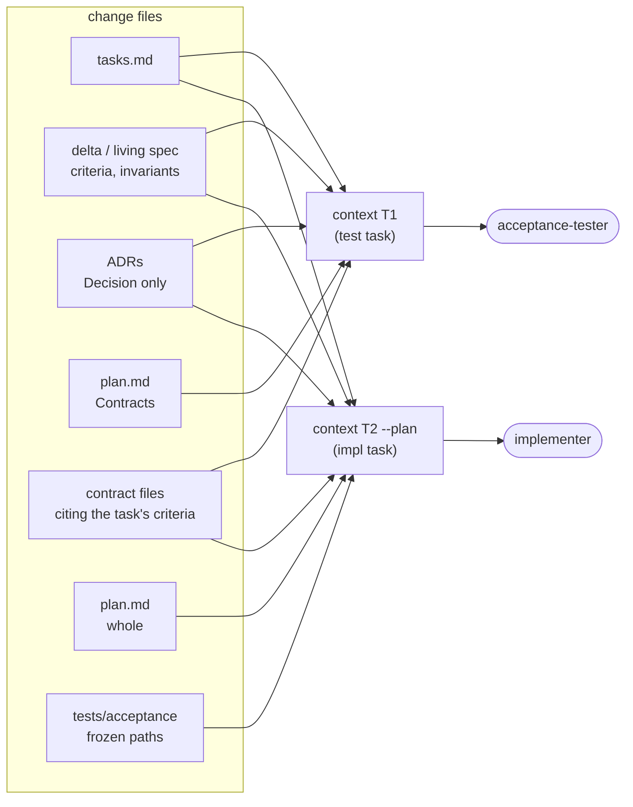

# Context bundles

`sdd context <change> <task> [--plan]` prints exactly what one agent needs for one task, and `sdd context <change> --contract` what the contract-designer needs for the whole change. The lead pastes it into the agent's prompt.

## What each task gets

| Part | test task | impl task | impl task with `--plan` |
|---|---|---|---|
| the task line and the lines of tasks it is blocked by | ✓ | ✓ | ✓ |
| the criteria (with their capability's Intent) and invariants it cites: the change's version if it touches them, else the living one | ✓ | ✓ | ✓ |
| the `## Decision` paragraph of each ADR it cites, with its status | ✓ | ✓ | ✓ |
| the id and title of every invariant in force that the task does not cite (`## Invariants in force`) | | ✓ | ✓ |
| the plan's `## Contracts` section | ✓ | | (in the full plan) |
| the contract files citing its criteria, in full (the change's copy, else the living file); paths of the others | ✓ | ✓ | ✓ |
| the paths of the frozen acceptance tests for its criteria | | ✓ | ✓ |
| the whole plan | | | ✓ |

The workflow uses `context <id> <Tn>` for test tasks and `context <id> <Tn> --plan` for impl tasks.

`context <id> --contract` gives the contract-designer the change's `surface`, the criteria it adds or modifies, and the contract files that cite them or the same capabilities, in full; other contract files by path. That bundle is why the contract-designer has no `Grep` or `Glob`: it designs the surface from the criteria and the current contract, not from the code.

## Why minimal

**Independence.** The acceptance-tester sees the criterion and the public contract, never the planned internals, so its tests check behavior and not implementation. The implementer gets the tests as read-only file paths: it must satisfy them, not redesign them.

**Accuracy.** The criterion text in the bundle is copied by the script from the files, so it is the current text, not the lead's paraphrase of it. For a criterion the change modifies, it is the new version.

**Cost.** An agent that reads the whole spec, every ADR and the lead's conversation spends most of its context on things that don't bear on its task. A bundle is usually a screen or two. The same reasoning drives the other token rules in the workflow: agents are resumed with `SendMessage` instead of re-spawned, and the lead gives you ids and paths, not file contents.

**ADR Decisions must stand alone.** Since implementers receive only the Decision paragraph, an ADR's Decision has to make sense without its Context and Options. An empty one shows as `(Decision section is empty: report this)`.
