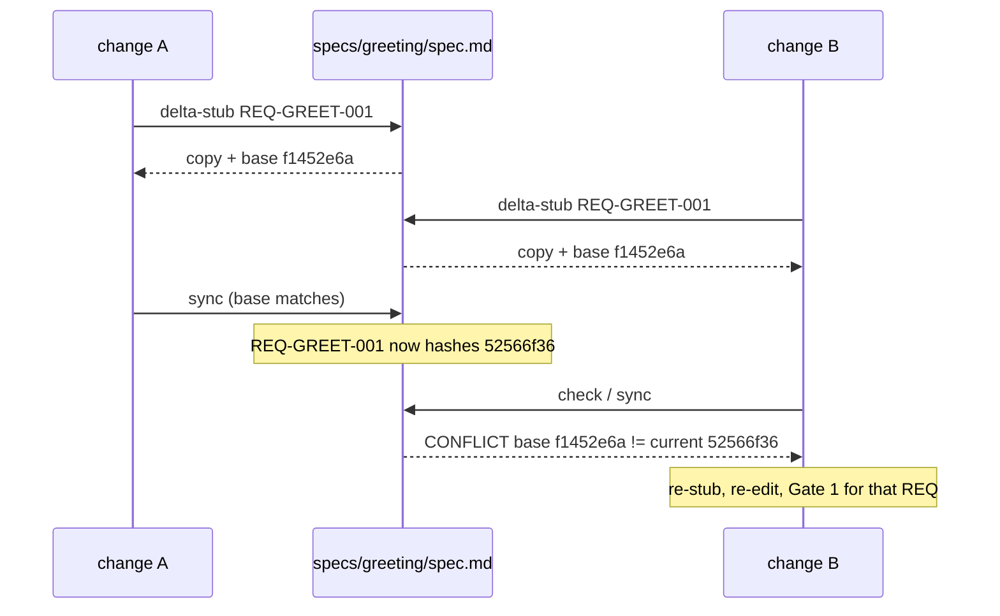

# Why sdd.py exists

A language model is good at writing a requirement. It is bad at copying one exactly: it rephrases, drops a clause, or reorders scenarios. In a workflow where the spec is the contract, a silent paraphrase is a bug nobody reviewed. So every operation that must be exact is done by `tools/sdd.py`, a plain Python script with no model calls, and agents only read its terse output.

## Sync merges by id, never by prose

`sdd sync` takes each delta block and applies it by REQ id. MODIFIED replaces the whole block with the delta's text, REMOVED drops it, ADDED appends it, and then the blocks are sorted by id. Nothing is summarised or rewritten. The text you approved at Gate 1 is the text that lands in `specs/`.

## Base hashes turn races into conflicts

Two open changes may modify the same requirement. When the spec-author runs `delta-stub`, the script copies the living block and records an 8-character hash of it as `<!-- base: ... -->`. If another change syncs first and edits that REQ, the hashes differ, and `sdd check` and `sdd sync` fail with:

```
ERROR specs/greeting.md REQ-GREET-001: CONFLICT base f1452e6a != current 52566f36 (living spec changed since this delta was written)
```



Without this, the second sync would silently overwrite the first change's work. The hash ignores trailing whitespace, so reformatting alone is not a conflict. Agents are told never to edit a hash: a conflict is real information, and the fix is to re-stub and re-review that REQ.

## Traceability is checked, not hoped for

`sdd check` fails when a REQ has no scenario, no test task or no implementation task, or when anything points at a REQ, ADR or task that doesn't exist. `check --tests` adds that every REQ has an acceptance test mentioning it and every task is ticked. Gate 2 can be automatic because of this. "Is everything covered?" is a question with a mechanical answer, so nobody has to judge it.

## Freezing makes "don't touch the tests" verifiable

`sdd freeze` records sha256 hashes of the acceptance test files that cover the change. `sdd verify-frozen` compares them again. The guard already refuses implementer writes to the tests, but it inspects tool calls heuristically. The hash check doesn't care how a file was changed, so a tampered test is a hard FAIL for the verifier, and CI can run the same check.

## Context bundles are computed, not chosen

`sdd context` assembles each agent's input from the files: the REQ blocks a task cites, the ADR Decision paragraphs, and the plan's Contracts or the whole plan. An agent therefore can't receive a stale or paraphrased copy of the requirement it works on. See [Context bundles](context-bundles.md).

## Git and gh calls are scripted too

Branch, worktree, commit, push, PR creation, dependency checks and the base merge all live in `sdd.py`. They are tested against a real bare `origin` with a fake `gh`. A phase is recorded only together with a commit and a push, so the stored state never gets ahead of what is on the remote.

## Terse on purpose

The output is read by agents, whose context is the scarce resource. One fact per line, `ERROR` lines that name the file and the fix, and a one-line `OK|FAIL` summary.
