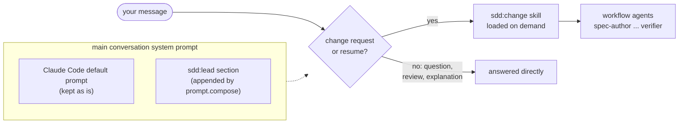

# Why the main conversation is the lead

With the plugin enabled, you just describe a change and the workflow runs. That works because the mod's `prompt.compose` hook appends a short `sdd:lead` section to the main conversation's system prompt. The section says: send change requests (and `resume <id>`) to the `sdd:change` skill verbatim, make behavior-preserving changes (a refactor, a rename, docs) directly, and answer questions, explanations and reviews directly.

## Why not a lead agent?

Claude Code can make a plugin agent the session's main agent. But that agent's prompt **replaces** Claude Code's whole default system prompt, which would mean losing tool guidance, safety rules and environment context. Appending a section keeps all of that and adds only the routing.

## Why so short?

The section is a router, not the workflow. The workflow (triage, gates, routing, close-out) lives in `skills/change/SKILL.md` and loads only when a change is actually requested. Questions about the codebase pay no context cost for a workflow they don't use, and neither does a rename: the router sends behavior-preserving changes straight to the direct path, which the skill's triage would choose anyway. Inside the skill, the paths most changes never take (resume, adopt, reopen, sync conflicts) are separate files next to `SKILL.md`, read only when a step sends the lead there.

## Why the lead doesn't write artifacts

The lead routes, gates and closes out. Specs, plans, tests and code are each written by one agent with one job and a minimal toolset. Three reasons:

- **Separation of duties.** The same mind shouldn't write a requirement, then the test for it, then the code that passes it. Each step checks the previous one only if they are independent.
- **Thin lead context.** The lead passes ids and paths and reads terse tool output. Its context stays small enough to run a long change without compaction.
- **The guard can enforce it.** Roles come from agent types, so per-artifact permissions are only possible if each artifact has its own agent.

The one exception is the direct path. For a refactor or a docs change, the lead may do the work itself or hand it to `general-purpose`, because there is no spec to protect.

## Side effect: project scope only

Since every session in which the plugin is enabled gets the lead section, installing it at user scope would turn every repository's main conversation into an sdd lead. Install it per project.
