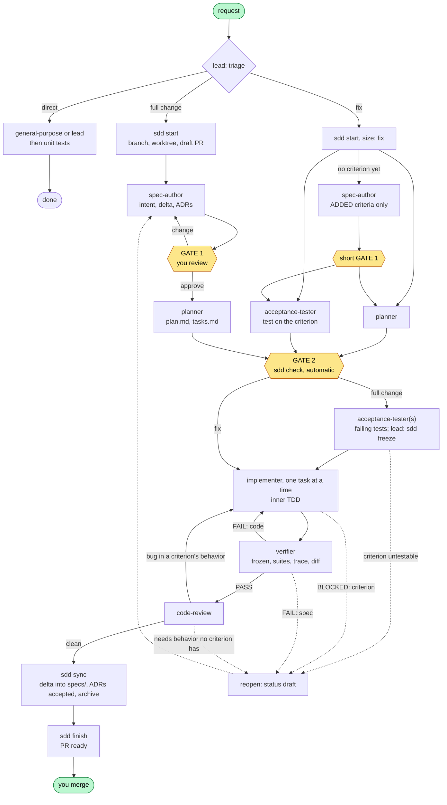

# How the workflow fits together

Solid arrows are the normal path and dotted arrows the failure path. Each box ends with an `sdd checkpoint` (commit and push).

## The spec is the contract, not the code

The living spec in `specs/` says what the system does now, as OKF concepts: a **Capability** per thing an actor can do, with one acceptance criterion (`AC-NN`, Given/When/Then) per observable behavior, and an **Invariant** per rule that must always hold, with a check that passes on an example and fails on a violation. A change never edits them directly. It proposes new concepts or a **delta** (criteria ADDED, MODIFIED, RETIRED, sections replaced), and the delta is merged only when the change is verified. So at any time `specs/` describes merged behavior, and an open change describes only its own difference.

Decisions with lasting consequences go into ADRs. An ADR is never edited once accepted: a new ADR supersedes it. The reasoning behind a past decision therefore stays readable.

## Triage first

Not every request deserves the full workflow. The lead sorts each one into one of three paths:

- **Full change**: it changes observable behavior or a public contract, or makes a lasting decision. It gets a spec delta and possibly ADRs.
- **Fix**: the code diverges from an existing criterion. No new spec is needed, since the criterion already says what is right. The lead writes a failing acceptance test against it first.
- **Direct**: refactors, renames, dependency bumps, docs, config. One agent does it and runs the unit tests.

In an existing repository `specs/` starts empty, so "existing criterion" is rare at first. A change that touches code no capability covers writes down the behavior it keeps as **Baseline** criteria (tested, already implemented), next to the criteria for what it changes. A bug without a criterion is a fix that first adds the criterion stating the correct behavior, reviewed in a short Gate 1. `adopt <area>` does the writing-down up front, for one area, without touching code. See [Adopt sdd in an existing repository](../how-to/adopt-an-existing-repo.md).

Without triage, either trivial work drowns in ceremony or real behavior changes slip through without a spec.

## Two gates of different weight

**Gate 1** is the only place where you have to read carefully. You review the why, the capabilities with their criteria, the invariants, and the decisions. Everything downstream (plan, tests, code) is derived from what you approve here, so this is where a misunderstanding is cheapest to fix.

**Gate 2** is automatic: `sdd check` proves that every criterion has Given/When/Then, a test task and an implementation task, that every invariant has a check and a test task, and that every reference resolves. You see a summary and may object, but it's built not to need you.

## Tests outside, TDD inside

The acceptance-tester writes tests from the criteria and the plan's Contracts **before** any code exists and confirms they fail for the right reason. Once every test task is back, the lead freezes the whole acceptance dir in one snapshot. Implementers then make those frozen tests pass, one task at a time, each with its own red-green-refactor loop of unit tests.

Two things follow:
- The acceptance tests come from the spec, not from the implementation, so they can't be quietly bent to fit the code. The guard and `verify-frozen` enforce this.
- Each agent sees only its slice. The tester doesn't know the implementation, and the implementer can't change the target. See [Context bundles](context-bundles.md).

## Failure goes back to the spec

When an implementer finds a criterion wrong, contradictory or untestable, it stops with `BLOCKED: <id>`. The lead reopens the spec (status back to `draft`), the spec-author fixes it, and you see Gate 1 again for the affected units only. The fix never happens in the code or the tests. That keeps the spec true: a criterion that couldn't be implemented as written is corrected where everyone reads it.

## Verify, review, sync

The verifier checks conformance: frozen tests untouched, suites green, full traceability, and a diff review against the spec, the ADRs and the non-goals. Since conformance doesn't catch bugs outside the criteria, a `code-review` pass follows. Its findings go to an implementer (test first) or back to the spec.

Only then does `sdd sync` merge the delta into `specs/`, accept the ADRs and archive the change. It does this deterministically, as described in [Why sdd.py exists](determinism.md).

## Every change is a branch and a PR

Each full change or fix lives on its own branch, in its own worktree, with a draft PR. After every artifact a checkpoint commits and pushes. The PR therefore shows the change growing one artifact at a time, and any machine can pick it up. See [Branches, PRs and checkpoints](branches-prs-checkpoints.md).

## Related

- [Your first change](../tutorials/first-change.md)
- [Phases, statuses and state.json](../reference/phases-and-states.md)
- [Workflow agents](../reference/agents.md)
