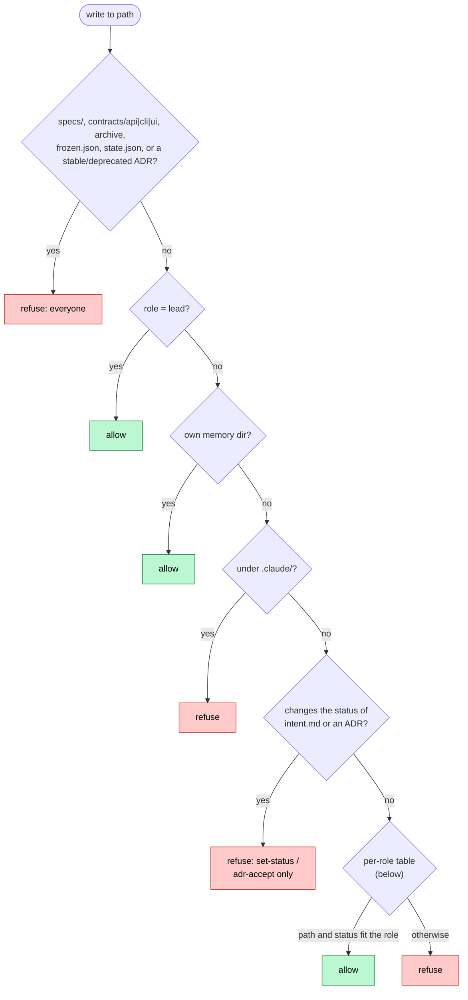

# Guard rules

The guard is a `tool.call` hook in the plugin's mod. It checks every `Edit`, `Write`, `MultiEdit`, `NotebookEdit` and `Bash` call before it runs. A refusal comes back to the caller as `[sdd-guard] <reason>`, shows as a toast, and is kept as the "last guard refusal" in the `/sdd` pane.

Paths in the rules use the configured directory names (`specs_dir`, `changes_dir`, `adr_dir`, `acceptance_dir`, `contracts_dir`), written here as their defaults.

## Roles

| Agent type reported by Claude Code | Role |
|---|---|
| none (no `agentId`: the main conversation) | `lead` |
| `sdd:spec-author`, `sdd:contract-designer`, `sdd:planner`, `sdd:acceptance-tester`, `sdd:implementer`, `sdd:verifier` | the name without `sdd:` |
| anything else (`Explore`, `general-purpose`, other plugins' agents, an unknown `sdd:` name) | `other` |

The role is looked up from the call's `agentId` with `$.agent.list()` and cached per agent id. An `agentId` the session does not list has no role: the call is refused, as a [guard failure](#failure-policy).

## File writes (`Edit`, `Write`, `MultiEdit`, `NotebookEdit`)

The path is resolved against the session cwd, then the project root (the root `sdd.py` reports). A subagent writing outside both is refused (`<path> is outside the project.`); the lead is not.

The checks run in this order (`checkPath`). The first one that matches decides:

The status check reads the file, applies the write to it (Write content, Edit or MultiEdit replacements, as the tool would) and compares the front-matter `status:` before and after. So an Edit that splices `draft` into `approved` mid-line counts, removing the line counts, and rewriting a file that keeps its status passes. A new ADR may be `draft` or have no status. When the file can't be read, the guard falls back to the `status:` lines the write adds.

### Everyone, the lead included

| Path | Rule |
|---|---|
| `specs/**` | refused: living specs change only through `sdd sync` (and `sdd bundle specs --fix`, run by the lead through the tool) |
| `contracts/api/**`, `contracts/cli/**`, `contracts/ui/**` | refused: living contracts change only through a change's `contracts/` and `sdd sync`. The rest of `contracts/` (tspconfig, emitter output) is not guarded |
| `changes/archive/**` | refused: archived changes are immutable |
| `changes/**/frozen.json` | refused: written only by `sdd freeze` |
| `changes/**/state.json` | refused: written only by `sdd.py` |
| `specs/.templates/**`, `adrs/.templates/**` | the lead only: the repo's concept templates |
| `adrs/index.md`, `adrs/log.md` | the lead only: generated by `sdd` (`adr-new`, `adr-accept`, `bundle adrs --fix`) |
| `adrs/*` with `status:` `stable` or `deprecated` (or `accepted`/`superseded` in an ADR not yet migrated; quoted values count) | refused: write a superseding ADR with `sdd adr-new <title> --supersedes ADR-NNNN` |

The lead passes every other write.

### Every subagent

| Path or content | Rule |
|---|---|
| its own memory dirs `.claude/agent-memory/sdd-<role>/`, `.claude/agent-memory-local/sdd-<role>/` | allowed (workflow roles only) |
| any other path under `.claude/` | refused |
| a write that leaves an ADR with another front-matter status than before (a new ADR: other than `draft` or none) | refused: ADR status moves only through `sdd adr-accept` |
| a write that leaves `changes/<c>/intent.md` with another front-matter status than before | refused: status moves only through `sdd set-status` |

### Per role

| Role | May write | While |
|---|---|---|
| `spec-author` | `adrs/**` (not its `index.md`, `log.md` or `.templates/`); `changes/<c>/intent.md`; `changes/<c>/specs/**` (new concepts and CapabilityDeltas under `capabilities/` and `invariants/`) | intent and delta only while the change is `draft` (or has no status yet). The generated `changes/<c>/index.md` is not writable: it comes from `sdd` |
| `contract-designer` | `changes/<c>/contracts/**` | change is `draft` (or has no status yet) |
| `planner` | `changes/<c>/plan.md`, `changes/<c>/tasks.md` | change is `draft` or `approved` |
| `acceptance-tester` | `tests/acceptance/**`, `changes/<c>/tasks.md` | any status |
| `implementer` | anything except `tests/acceptance/**`, `adrs/**` and `changes/**` (but `changes/<c>/tasks.md` is allowed) | any status |
| `verifier` | nothing (its memory dirs aside) | — |
| `other` | anything not covered by the rules above | — |

## Bash

The lead's Bash calls are not checked. For subagents:

1. A command mentioning `tools/sdd.py` is refused: use the `sdd` tool.
2. The command is split into segments at `;`, `&&`, `||`, `|`, `&` and newlines (outside quotes), after dropping fd duplications (`2>&1`) and `/dev/null` sinks. A `cd` or `pushd` segment moves the directory the next segments resolve paths from (`cd`, `cd -`, `cd ~/...`, `cd $X` go back to the cwd).
3. A segment writes when it has a redirect into a file (`>`, `>>`, `x>f`, `&>`) or contains `tee`, `sed -i`, `perl -i`, `mv`, `cp`, `rm`, `touch`, `ln`, `mkdir`, `rmdir`, `truncate`, `dd`, `git checkout|restore|rm|mv|apply`, `patch`, `install`, `write_text`, or `open(..., 'w'|'a')`. Other segments pass.
4. A writing segment's candidate paths are its redirect targets, and, when it writes by more than a redirect:
   - every word containing `/` or ending in `.md`;
   - every argument, once a `cd` moved away from the cwd;
   - for the `verifier`, the operands of `tee`, `touch`, `cp`, `mv`, `rm`, `truncate`, `install`, `ln`, `mkdir`, `rmdir` and `sed`.

   So `pytest tests/acceptance > /tmp/log` checks only `/tmp/log`. Each candidate is resolved from the segment's directory, and:
   - `verifier`: refused if it is inside the project.
   - `implementer`: refused if it is under `tests/acceptance/`, or under `changes/` and not a `tasks.md`.
   - any subagent: refused if it is under `specs/`, `adrs/`, `.claude/`, `changes/archive/`, `contracts/api|cli|ui/`, or is a `frozen.json` / `state.json` under `changes/`.

This check is a heuristic backstop: a path built at run time (`python -c "...write_text(...)"`) gets past it. `sdd verify-frozen`, run by the verifier and ideally in CI, is the real enforcement for the acceptance tests: it hashes the whole acceptance dir, helpers and fixtures included, and reports added files too.

## Failure policy

If the guard itself throws, it refuses the call for a subagent (`the guard failed; refusing for safety.`) and lets the lead's call through. A call whose `agentId` the session does not list takes the same path: no role, so no write.

## Related

- [Why the guard is designed this way](../explanation/guard-design.md)
- [sdd tool roles](sdd-tool-roles.md)
