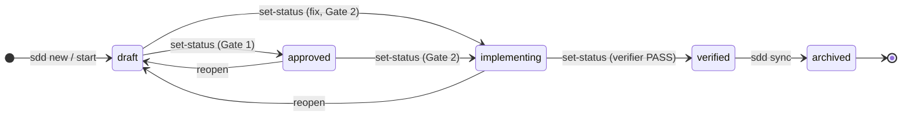
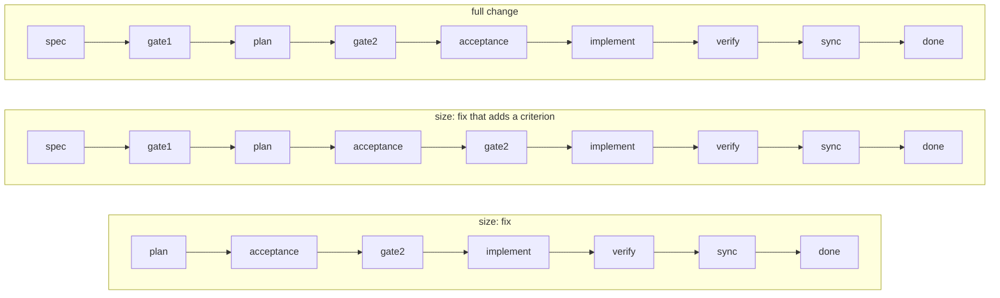
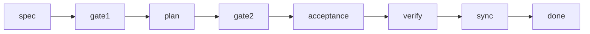
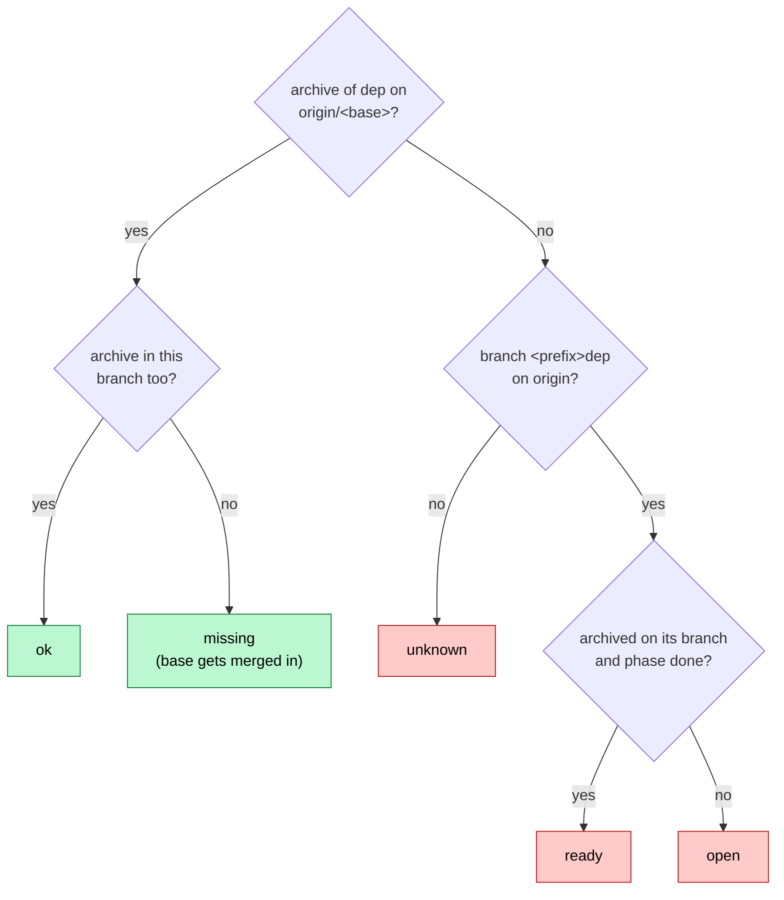

# Phases, statuses and state.json

A change has two independent markers:

- its **status**, in `intent.md` front matter, moved by `sdd set-status` and `sdd sync`;
- its **phase**, in `state.json`, moved by `sdd checkpoint --phase` and `sdd finish`.

## Statuses

| Status | Set by | Meaning |
|---|---|---|
| `draft` | template | spec being written; spec-author may edit intent and delta |
| `approved` | `set-status` after Gate 1 | spec frozen; planner may still edit plan and tasks |
| `implementing` | `set-status` after Gate 2 | plan frozen; tests and code being written |
| `verified` | `set-status` after the verifier passes | ready to sync |
| `archived` | `sync` | merged into `specs/`, moved to `changes/archive/` |

## Phases

| Phase id | Label | Workflow step | Statuses that fit |
|---|---|---|---|
| `spec` | Spec | 2: spec-author writes intent, delta, ADRs | `draft` |
| `gate1` | Gate 1 | 3: your review | `draft` |
| `plan` | Plan | 4: planner writes plan and tasks | `draft`, `approved` |
| `gate2` | Gate 2 | 5: `sdd check`, then set implementing | `draft`, `approved` |
| `acceptance` | Acceptance tests | 6: acceptance-testers, then the lead freezes | `draft`, `implementing` |
| `implement` | Implement | 7: implementers, one task at a time | `implementing` |
| `verify` | Verify | 8: verifier, then code-review | `implementing` |
| `sync` | Sync | 8.4: `sdd sync`, then `sdd finish` | `verified` |
| `done` | — | nothing left: the PR is ready for review | `archived` |

### Phase and status

`sdd check` warns `state.json phase '
' does not fit status '<s>'` when the pair is not in the table. A fix stays `draft` through plan and acceptance, hence those extra statuses.

### Order for a fix

A change with `size: fix` in `intent.md` skips Spec and Gate 1, and writes its acceptance test alongside the plan, before Gate 2. A fix in code that no criterion covers first adds the criterion: it starts with Spec and a short Gate 1 (its stored phase is `spec` or `gate1`, or it has files under `changes/<id>/specs/`), still in status `draft`:

### Order for a baseline

A change with `size: baseline` (an adopt) writes down what the code does, so it has no Implement step: acceptance goes straight to verify.

### Derived phase

The band and panes show the stored phase. For a change without one (made before `state.json` existed), or whose stored phase is not part of its workflow, the phase is derived from the status, the open tasks and the running workflow agents:

| Status | Derived phase |
|---|---|
| `draft`, full change | `spec` while spec-author runs, else `gate1` |
| `draft`, fix with a delta and no tasks | `spec` while spec-author runs, else `gate1` |
| `draft`, fix | `plan` while planner runs or no `(impl)` task yet; then `acceptance` while acceptance-tester runs or a `(test)` task is open; else `gate2` |
| `approved` | `plan` while planner runs or no tasks; else `gate2` |
| `implementing`, baseline | `acceptance` while acceptance-tester runs or a `(test)` task is open; else `verify` |
| `implementing` | `acceptance` while acceptance-tester runs or a `(test)` task is open; `implement` while implementer runs or an `(impl)`/`(chore)` task is open; else `verify` |
| `verified` | `sync` |

## state.json

`changes/<id>/state.json`, written only by `sdd.py`:

| Field | Type | Written by | Meaning |
|---|---|---|---|
| `phase` | phase id | `start` (`spec`), `checkpoint --phase`, `finish` (`done`) | current workflow phase |
| `branch` | string | `start` | `<branch_prefix><id>` |
| `base` | string | `start` | base branch the change targets |
| `pr` | int \| null | `start` (via `gh`), `set-pr` | PR number |
| `pr_url` | string \| null | `start`, `set-pr --url` | PR URL |
| `requires` | string[] | `start --requires`, `requires` | changes that must be merged first |
| `baseline` | `{commit, files}` | `freeze` | the base commit the Baseline tests pass on, and their hashes; `baseline-tree` re-creates that commit |
| `updated` | ISO date | every save | last write |

## Dependency states

`sdd deps`, `resume` and `checkpoint --phase plan|...` classify each required change, transitively:

| State | Meaning | Blocks? |
|---|---|---|
| `ok` | its archive is on `origin/<base>` and in this branch | no |
| `missing` | merged into the base, not in this branch yet | no: `checkpoint`/`resume` merge `origin/<base>` in |
| `ready` | `finish` ran (phase `done`), PR not merged | yes: `next: merge the PR of <dep>` |
| `open` | still being worked on (even if synced but not finished) | yes: `next: resume <dep>` |
| `unknown` | no branch `<branch_prefix><dep>` on origin | yes: check `requires` |

"Merged" means the dependency's `changes/archive/<date>-<dep>/` directory exists on `origin/<base>`, so squash merges count. A cycle is refused.
