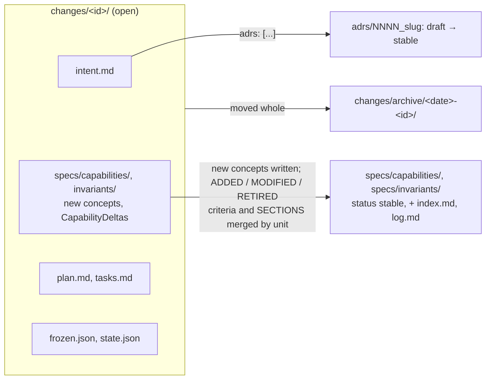

# Repository layout

Default directory names; each is configurable (see [Configuration](configuration.md)). `specs/`, `adrs/` and each change are OKF bundles: see [OKF bundles](bundles.md).

```
specs/index.md, specs/log.md             generated: okf index of the bundle, one log line per sync
specs/capabilities/<id>.md               living Capability: what an actor can do, criteria AC-NN
specs/invariants/<id>.md                 living Invariant: one rule that always holds, with its check
specs/.templates/                        Capability and Invariant templates (not concepts)
adrs/NNNN_<slug>.md                      one decision per file; adrs/index.md, log.md, .templates/
changes/<id>/index.md                    generated: okf index of the change
changes/<id>/intent.md                   why, scope, non-goals; front matter status/size/adrs
changes/<id>/specs/capabilities/<id>.md  a new Capability, or a CapabilityDelta of a living one
changes/<id>/specs/invariants/<id>.md    a new Invariant, or the replacement of a living one
changes/<id>/plan.md                     approach, contracts, components, risks
changes/<id>/tasks.md                    task checklist
changes/<id>/frozen.json                 hashes of the frozen acceptance tests
changes/<id>/state.json                  phase, branch, base, PR, requires
changes/archive/<YYYY-MM-DD>-<id>/       a synced change, immutable
tests/acceptance/                        acceptance tests citing criterion and invariant ids
.claude/sdd.json                         project configuration
.claude/worktrees/sdd-<id>/              one worktree per change (git-ignored)
.claude/agent-memory/sdd-<agent>/        per-agent project memory
.claude/agent-memory-local/sdd-<agent>/  per-agent memory kept out of git
```

How a change's files move at `sdd sync`:



Acceptance tests stay where they are in `tests/acceptance/` and become part of the regression suite.

## Who writes what

| Path | Written by |
|---|---|
| `specs/**` | `sdd sync`; `sdd bundle specs --fix` (lead) for layout, front matter and indexes |
| `adrs/*` (draft) | spec-author, via `sdd adr-new` then Edit |
| ADR `status:`, `adrs/index.md`, `adrs/log.md` | `sdd adr-new`, `sdd adr-accept` / `sdd sync` |
| `intent.md` body, delta | spec-author, while `draft` |
| `changes/<id>/**/index.md` | `sdd new`, `delta-new`, `delta-stub`, `checkpoint`, `sync`, `bundle <id> --fix` |
| `intent.md` `status:` | `sdd set-status` / `sdd sync` |
| `plan.md`, `tasks.md` | planner, while `draft` or `approved` |
| task ticks in `tasks.md` | acceptance-tester and implementer, each its own task |
| `tests/acceptance/**` | acceptance-tester |
| `frozen.json` | `sdd freeze` |
| `state.json` | `sdd start`, `checkpoint`, `set-pr`, `requires`, `finish`; `freeze` (the `baseline` record) |
| `changes/archive/**` | `sdd sync` (move), `sdd finish` (`state.json` phase) |
| source code, unit tests | implementer (or `general-purpose` on the direct path) |
| `.claude/sdd.json` | `sdd init`, then you |

Enforcement: [Guard rules](guard-rules.md).

## What to commit

Commit everything above except `.claude/worktrees/` (`sdd init` adds it to `.gitignore`). `.claude/sdd.json` must be committed and pushed to the base branch before `sdd start`. Committing `.claude/agent-memory/` is optional: see [Share agent memory](../how-to/share-agent-memory.md).
